<div align="center">

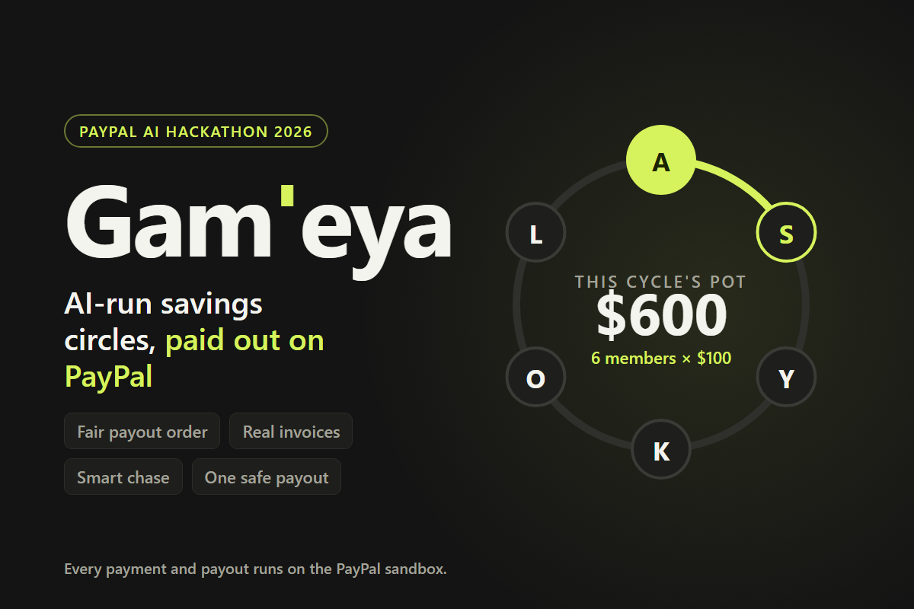

# Gam'eya

**The world's oldest way to save, run by AI and paid out on PayPal.**

A group saves together and one member takes the whole pot each cycle.<br>
PayPal moves the money, AI helps run the circle, and humans approve anything that changes who gets paid.

[](https://gameya-web.onrender.com/)
[](#paypal-integration)
[](#quality)
[](LICENSE)


**[Live app](https://gameya-web.onrender.com/)** · **[For judges](#try-it-in-2-minutes)** · **[How it works](#how-a-cycle-works)** · **[Architecture](#architecture)** · **[Run locally](#run-it-locally)**

<sub>Built for the <b>PayPal AI Hackathon 2026</b>. Everything runs on the PayPal Sandbox: no real money moves.</sub>

</div>

---

## The problem

In Egypt it's a **gam'eya**. In Mexico, a *tanda*; in West Africa, a *susu*; in India, a *chit fund*. Hundreds of millions of people save this way: each member pays a fixed amount every cycle, and one member takes the whole pot. It is interest-free credit built on trust.

But it runs on WhatsApp and memory:

| | Today | With Gam'eya |
|---|---|---|
| **Records** | Nobody keeps a ledger | Every payment carries its real PayPal id |
| **Payout order** | Argued over: "who needs it first?" | An optimiser decides from members' needs, and everyone approves |
| **Late payers** | Awkward follow-ups, or none | Smart Chase sends a polite reminder in the member's language |
| **Payouts** | Cash, with no check the pot is complete | One PayPal payout, only after the ledger balances |
| **Risk** | Guesswork | A reliability model and a 10,000-run stress test recommend a reserve |

> [!IMPORTANT]
> **Our golden rule:** *AI understands and advises. Deterministic code moves the money. Humans approve anything that changes who gets paid.*

---

## Features

<table>
<tr>
<td width="50%" valign="top">

### Set up by chat
Describe the circle in plain words ("6 friends, $100 a month, starting 1 December"). The **Circle Agent** fills in a card; when you confirm, it creates a real PayPal **product and billing plan**.

### A fair payout order
Members say what they need the pot for, in **English or Egyptian Arabic**. The **Hungarian algorithm** gives each member the slot that best fits their need, and every member approves before it applies.

### Real PayPal invoices
**Collect** sends every member a PayPal invoice, which they pay on **PayPal's own page**. **Sync** reads the status back; only money PayPal actually received counts.

</td>
<td width="50%" valign="top">

### Smart Chase
Late after the grace period? Smart Chase sends a reminder in the member's language, using only allow-listed PayPal tools and never asking for more than the contribution.

### One safe payout
**Close** checks four ledger invariants, then pays the pot with **PayPal Payouts**, exactly once, even if you press it twice.

### Explainable risk, organiser-only
Each member's chance of paying late with its **top three reasons**, and a **Monte Carlo stress test** that recommends a safety reserve. Members never see anyone's score.

</td>
</tr>
</table>

---

## Screenshots

<table>
<tr>
<td width="50%">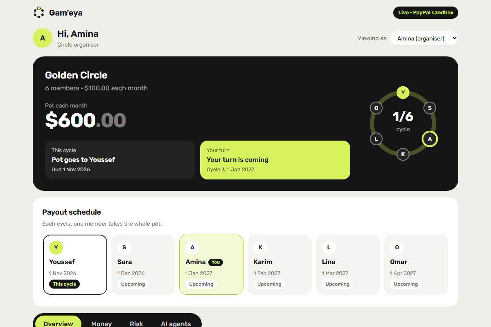<br><sub><b>Organiser dashboard:</b> the $600 pot, the payout ring and the approved schedule.</sub></td>
<td width="50%">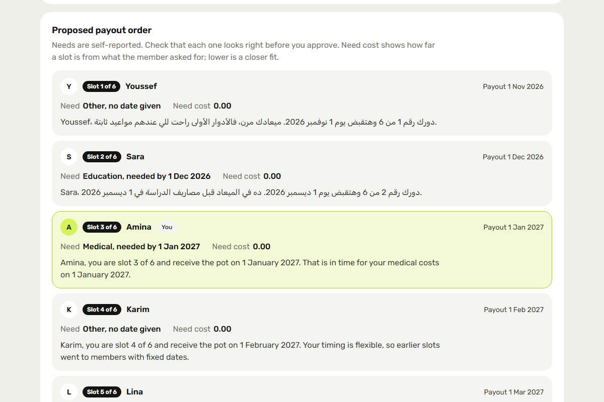<br><sub><b>Fair order:</b> each member's slot, need and a reason in their own language.</sub></td>
</tr>
<tr>
<td>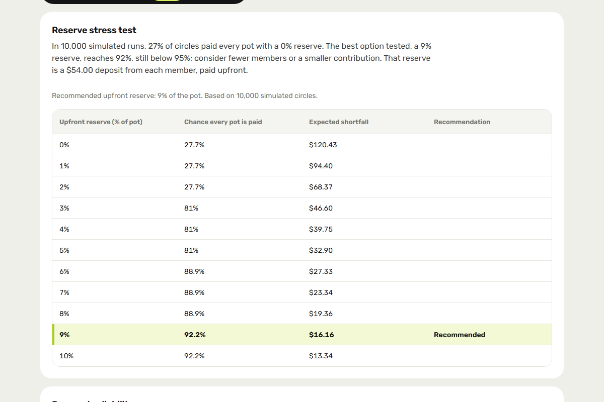<br><sub><b>Stress test:</b> 27.7% of circles complete with no reserve; 92.2% with the recommended 9%.</sub></td>
<td>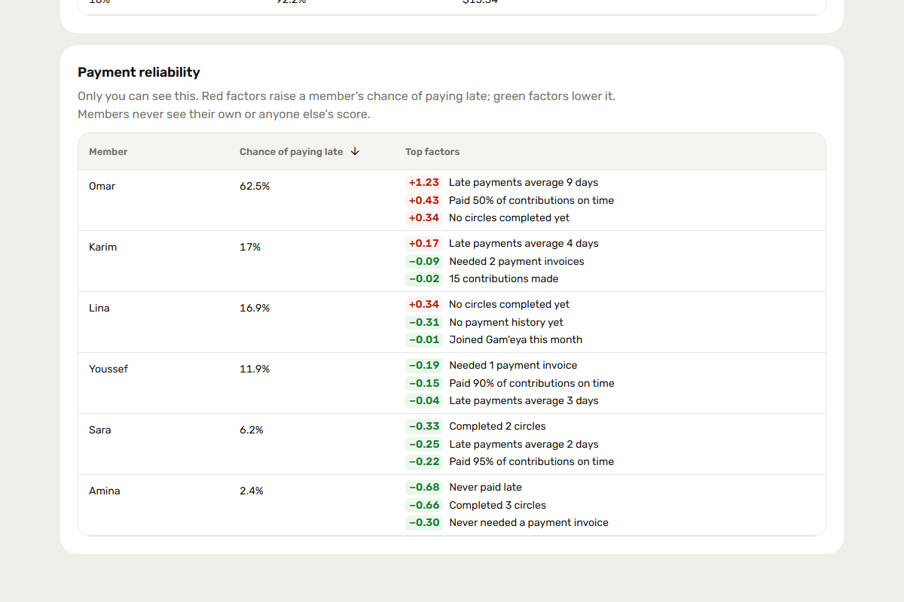<br><sub><b>Reliability (organiser-only):</b> chance of paying late with the top three reasons.</sub></td>
</tr>
<tr>
<td>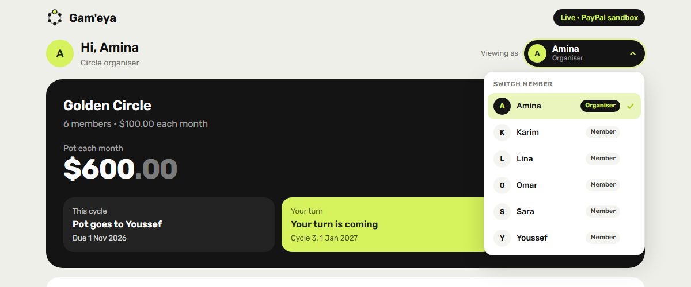<br><sub><b>Switch member:</b> try the app as any of the six members.</sub></td>
<td>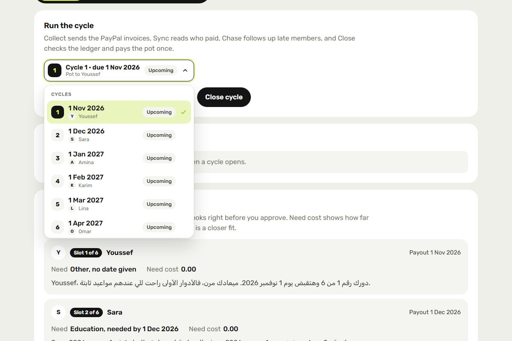<br><sub><b>Run the cycle:</b> every cycle with its date, recipient and status.</sub></td>
</tr>
<tr>
<td>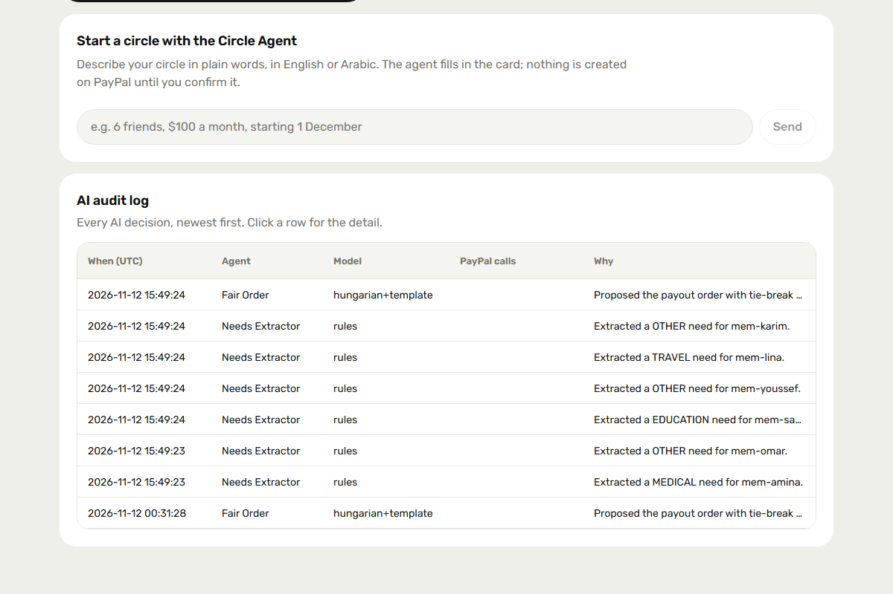<br><sub><b>AI agents:</b> the Circle Agent chat and the audit log of every AI decision.</sub></td>
<td>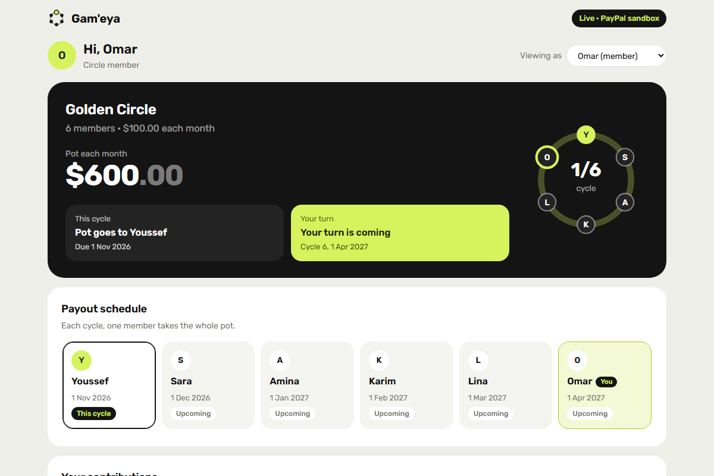<br><sub><b>Member view:</b> when the pot comes to them, their invoices, and no risk data.</sub></td>
</tr>
<tr>
<td colspan="2" align="center">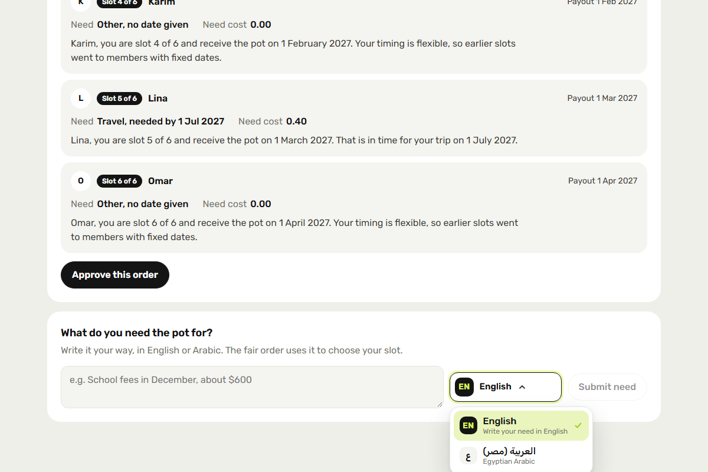<br><sub><b>Needs in your language:</b> members write what the pot is for in English or Egyptian Arabic, and the order explains each slot.</sub></td>
</tr>
</table>

---

## Try it in 2 minutes

> [!TIP]
> Open **[gameya-web.onrender.com](https://gameya-web.onrender.com/)**. It runs on Render's free tier, so the **first load can take about 30 seconds** while the API wakes up.

1. **Look around as the organiser.** The app opens as **Amina**. Use the tabs:
   - **Overview:** the payout order and the cycle buttons.
   - **Money:** the ledger with real PayPal ids.
   - **Risk:** the stress test and reliability.
   - **AI agents:** the chat and the audit log.
2. **Switch member.** Use **Viewing as** (top right) to become Omar, Sara, Youssef, Lina or Karim. Each switch logs in with a signed demo token, and the member view hides all risk data.
3. **Run a cycle** (as Amina, after each member has submitted a need and approved the order):

   **Collect** → members **Pay with PayPal** → **Sync payments** → **Chase** → **Close cycle**

<details>
<summary><b>Sandbox buyer accounts</b> (to pay invoices on PayPal's page)</summary>

| Member | Sandbox email |
|---|---|
| Amina (organiser) | `amina-buyer@gameya-sandbox.dev` |
| Omar | `omar-buyer@gameya-sandbox.dev` |
| Sara | `sara-buyer@gameya-sandbox.dev` |
| Youssef | `youssef-buyer@gameya-sandbox.dev` |
| Lina | `lina-buyer@gameya-sandbox.dev` |
| Karim | `karim-buyer@gameya-sandbox.dev` |

The passwords are in the Devpost submission, not in this repository. Setup details: [docs/sandbox.md](docs/sandbox.md).

</details>

---

## How a cycle works

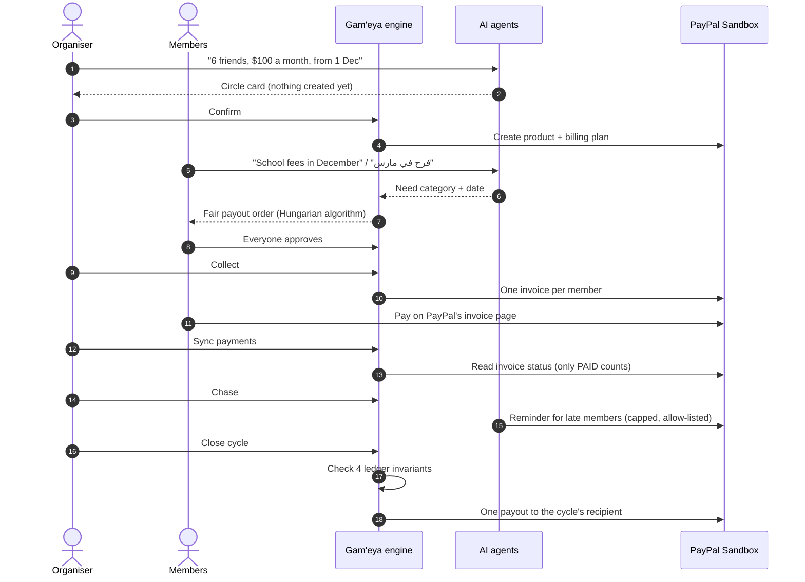

---

## Architecture

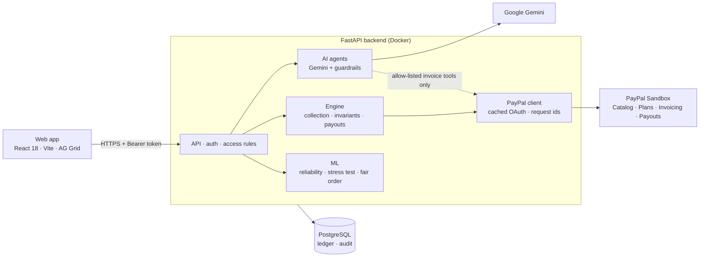

> [!NOTE]
> No module under `app/ai` can import the payout or collection code, and a test fails the build if one tries. AI can advise and send reminders; only the deterministic engine moves money.

| Layer | Responsibility | Code |
|---|---|---|
| API | Routes, signed demo-login tokens, organiser and member checks | [`backend/app/api/`](backend/app/api/) |
| AI agents | Circle Agent, Smart Chase, Needs Extractor, guardrails | [`backend/app/ai/`](backend/app/ai/) |
| Engine | Collection, payout invariants, per-cycle locks | [`backend/app/domain/`](backend/app/domain/) |
| ML | Reliability model, synthetic data, stress test | [`backend/app/ml/`](backend/app/ml/) |
| PayPal | OAuth token cache, invoicing, payouts | [`backend/app/services/paypal/`](backend/app/services/paypal/) |
| Web | Screens, shared dropdowns, AG Grid ledger and audit | [`frontend/src/`](frontend/src/) |

---

## PayPal integration

| API | What we use it for | Triggered by |
|---|---|---|
| **OAuth 2.0** | Cached token, refreshed 5 minutes early, one refresh even under concurrency | Every call |
| **Catalog Products** | One product per circle | Organiser confirms the card |
| **Billing Plans** | The circle's monthly plan; the reserve as `setup_fee` | Organiser confirms the card |
| **Invoicing v2** | Create, send and read each member's invoice; reminders; QR codes | Collect · Sync · Chase |
| **Payouts v1** | The cycle's pot to its recipient, one batch per cycle | Close cycle |

- **Idempotent:** every POST carries a deterministic `PayPal-Request-Id`, so a retry can never create a second invoice or payout.
- **Invoicing detail:** reminder text goes into the invoice note at creation, because `/send` ignores later text.
- **Sandbox only:** the app refuses to start against any non-sandbox PayPal URL.

---

## AI and machine learning

| Component | What it does | Model · fallback |
|---|---|---|
| **Circle Agent** | Chat → circle card → PayPal product and plan on Confirm | Gemini · regex slot-filling |
| **Needs Extractor** | English or Egyptian Arabic text → category, date, urgency | Gemini · rule-based |
| **Fair order** | Optimal one-member-per-slot assignment with an unsteerable, seeded tie-break | Hungarian algorithm (no LLM decides) |
| **Smart Chase** | Nudge, reminder or invoice for each unpaid member, in their language | Gemini wording, validated · templates |
| **Reliability** | Chance of paying late next cycle, with the top three reasons | Logistic regression on simulated data, **no demographic features** |
| **Stress test** | 10,000 simulated circles per reserve level, 0–10% | Vectorised NumPy Monte Carlo |

**Guardrails:** per-agent tool allow-lists · a contribution cap re-checked just before PayPal is called · AI text with invented numbers, dates, links or contacts is rejected · member text wrapped as untrusted input · every AI decision logged with its model, rationale and PayPal calls.

**Built with AI assistants:** AI coding assistants (including Claude Code) were used for planning, implementation, tests and code review; every change went through automated tests and human review.

---

## Money safety

Before **any** HTTP call, closing a cycle checks four invariants:

1. **The pot is complete:** settled contributions equal amount × members.
2. **One payout per cycle:** a payout PayPal accepted is returned, never sent again.
3. **Never paid twice:** each payout stores its recipient, so a later order change cannot hide it.
4. **Deliverable:** the recipient has an email address.

<details>
<summary><b>Failure modes we tested for</b></summary>

| Failure | Protection |
|---|---|
| Crash or retry during a payout | The payout row is written first with a deterministic `sender_batch_id`; a retry reuses it |
| PayPal refuses the payout | Marked FAILED and retried with the same id; never reported as sent |
| Demo reset | Ids carry a stamp of the circle row, so PayPal never replays an earlier run |
| Two presses at once | Per-cycle lock: the second request gets 409 |
| Order changed after approval | Collect refuses until everyone approves; the order is fixed once collection starts |
| Invoice created but not sent | Stored and resent by the next Chase; never created twice |
| Merchant marks an invoice paid | Only PayPal's `PAID` counts |

Money is always `Decimal`, rounded to the cent (ROUND_HALF_UP) and sent as strings. With `PAYOUTS_ENABLED=0`, Close records a **BLOCKED** payout instead of faking one.

</details>

---

## Security and privacy

- **Identity:** HMAC-signed demo-login tokens; organiser rights come from server-side data, never from the browser.
- **Server-side access rules:** reliability, ledger, audit and the stress test are organiser-only; members act only for themselves.
- **Privacy by design:** no demographic features; scores are never shown to members; only the extracted need is stored, not the raw text.
- **Secrets:** only in environment variables or a git-ignored `.env`; CI scans the full git history.
- **Web:** plain-text rendering everywhere (no HTML injection), CORS restricted to the web app, token in memory only.

---

## Quality

| | |
|---|---|
| **Backend** | **864 tests**: unit, integration and property-based (Hypothesis); PayPal mocked at the HTTP layer (respx) |
| **Frontend** | **36 tests** (Vitest + Testing Library), including "member view never requests risk data" and keyboard-accessible dropdowns |
| **Static checks** | ruff · strict mypy · `tsc --noEmit` |
| **CI** | gitleaks (full history) → ruff → mypy → pytest → tsc on every pull request |
| **Reviews** | Two independent whole-branch reviews; every Critical and Important finding fixed with a test that failed first |

```bash
cd backend  && pytest && ruff check app tests && mypy
cd frontend && npx tsc --noEmit && npx vitest run
```

---

## Run it locally

<details open>
<summary><b>Quick start</b></summary>

**Prerequisites:** Python 3.11, Node 20, and a PayPal developer **sandbox** app with **Invoicing** and **Payouts** enabled. A Gemini API key is optional.

```bash
# 1. Backend
cp .env.example backend/.env        # add your PayPal sandbox credentials
cd backend
pip install -r requirements.txt
set -a && . ./.env && set +a        # load the env file (bash)
DEMO_MODE=1 uvicorn app.main:app --port 8000

# 2. Frontend (new terminal)
cd frontend
npm install
VITE_USE_MOCKS=0 VITE_API_BASE_URL=http://localhost:8000 npm run dev
```

Open http://localhost:5173. With `DEMO_MODE=1`, a fresh database gets the golden demo circle automatically. Use `VITE_USE_MOCKS=1` to run the UI on fixtures without a backend.

</details>

<details>
<summary><b>Docker</b></summary>

```bash
docker compose up --build            # API on :8000, web on :5173
```

</details>

<details>
<summary><b>Configuration</b></summary>

| Variable | Meaning |
|---|---|
| `PAYPAL_API_BASE_URL` | Must be `https://api-m.sandbox.paypal.com` (anything else refuses to start) |
| `PAYPAL_CLIENT_ID` / `PAYPAL_CLIENT_SECRET` | Sandbox app credentials |
| `PAYOUTS_ENABLED` | `1` (default). `0` records a BLOCKED payout and sends nothing |
| `GEMINI_API_KEY` | Optional; without it every AI feature uses its fallback |
| `DEMO_MODE` | `1` enables demo personas, seeding, and admin reset/fast-forward |
| `SESSION_SECRET` / `ADMIN_TOKEN` | Required in production (Render generates them) |
| `DATABASE_URL` | PostgreSQL on Render, SQLite locally |

</details>

<details>
<summary><b>API reference</b></summary>

Interactive docs at `/docs` on the API. All routes are under `/api/v1`.

| Route | Access |
|---|---|
| `POST /auth/demo-login` | Anyone (demo personas) |
| `POST /agent/circle/chat` · `POST /circles` | Logged in |
| `GET /circles/{id}` | Anyone (names, slots, dates; no money or risk data) |
| `GET /circles/{id}/my-invoices` | Member (own invoices only) |
| `POST` · `GET /circles/{id}/needs` | Member (own need only) |
| `POST /circles/{id}/order/propose` · `/order/approve` | Member |
| `POST /circles/{id}/stress-test` · `GET /reliability` | Organiser |
| `GET /circles/{id}/ledger` · `GET /audit` | Organiser |
| `POST /cycles/{id}/collect` · `/sync` · `/chase` · `/close` | Organiser |
| `POST /admin/reset-demo` · `/admin/cycles/{id}/fast-forward` | Demo mode + `X-Admin-Token` |

</details>

<details>
<summary><b>Repository layout</b></summary>

```
backend/app/
├── api/            routes: circles, cycles, agent chat, admin, auth
├── ai/             agents, guardrails, Gemini chain, PayPal toolkit adapter
├── domain/         collection, circle engine (payouts), locks, clock
├── ml/             reliability model, synthetic data, stress test
└── services/       PayPal OAuth, invoicing, payouts; circle data; ledger view
frontend/src/
├── components/     shared Dropdown, member/cycle pickers, cycle actions, cards
├── grids/          AG Grid: ledger, audit, reliability, stress test
└── pages/          organiser dashboard, member home, Circle Agent chat
shared/fixtures/    golden demo data (mock mode)
docs/               sandbox setup, demo script, ML assumptions, production notes
```

</details>

---

## Deployment

[`render.yaml`](render.yaml) is a **Render Blueprint** on the free tier: the API (Docker), the static web app and PostgreSQL.

1. Render → **New → Blueprint** → pick this repository.
2. Set `PAYPAL_CLIENT_ID`, `PAYPAL_CLIENT_SECRET`, `PAYPAL_API_BASE_URL` and, optionally, `GEMINI_API_KEY`.
3. Check `GET /api/v1/health` shows `paypal: healthy`.

> [!WARNING]
> After the first deploy, check that the URLs Render assigned match `CORS_ORIGINS` (API) and `VITE_API_BASE_URL` (web) in `render.yaml`. `VITE_*` values are fixed at build time, so redeploy the web app after changing them. Free PostgreSQL expires after 30 days; recreate it from the Blueprint and the API reseeds the demo circle at startup.

---

## Scope and roadmap

<table>
<tr>
<td width="50%" valign="top">

### Not built yet
- Members pay by **invoice**; they don't subscribe to the billing plan yet.
- The **webhook** receiver refuses events until signature verification is wired.
- **Copilot, swaps, joining, pay-now and mediation** still serve demo data (`X-Demo-Fixture` header).
- The reserve isn't yet used to cover a missed payment.
- Payout status isn't refreshed after PayPal accepts it.
- No KYC, no real money, USD only.

</td>
<td width="50%" valign="top">

### What's next
1. Member **subscriptions** and **verified webhooks** for real-time status.
2. Use the **reserve** to cover a missed payment automatically.
3. Wire **joining, swaps and the Copilot** to the engine.
4. Production: a licensed money-transmission partner or PayPal's multiparty flows, KYC, more currencies, a mobile app.

</td>
</tr>
</table>

More detail: [docs/production-considerations.md](docs/production-considerations.md) · [docs/ml-assumptions.md](docs/ml-assumptions.md)

---

<div align="center">

**Built by the Gam'eya team for the PayPal AI Hackathon 2026**

[Live app](https://gameya-web.onrender.com/) · [Contributors](https://github.com/ahmed-paypal-hackathon-2026/Gameya/graphs/contributors) · [MIT License](LICENSE)

<sub>Gam'eya is an independent hackathon project and is not affiliated with or endorsed by PayPal. "PayPal" is used only to name the APIs the project integrates with.</sub>

</div>
